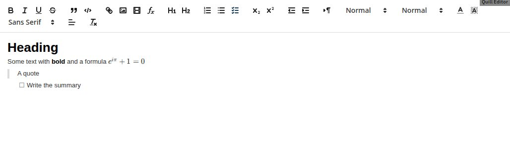

# Module Quill

A collaborative rich-text editor module for [Edrys-Lite](https://github.com/edrys-labs/edrys-Lite) classrooms,
built on [Quill](https://quilljs.com/) with real-time CRDT sync and live cursors. It supports headings, lists,
checklists, links, images, YouTube/Vimeo videos and formulas ([KaTeX](https://katex.org/)).



## Usage

Add this URL to your Edrys-Lite classroom:

```
https://edrys-labs.github.io/module-quill/
```

The module is shown in every room (`show-in: *`). It follows each device's light or dark preference.

## Configuration

All fields are optional; empty ones fall back to their defaults.

```json
{
  "synchronize": true,
  "editorId": "notes",
  "placeholder": "Write your answer here…",
  "toolbar": "basic",
  "maxImageKB": 500,
  "blockRemoteImages": false
}
```

| Field | Type | Default | Description |
|---|---|---|---|
| `synchronize` | boolean | `false` | Share one document across all peers in the room, edited in real time, with live cursors. Without it, each person edits their own copy, kept in their browser (per class and room). |
| `editorId` | string | `""` | Separates the documents of several Quill modules in one room. **Set a different value on each instance**; without it they share one document. |
| `placeholder` | string | see below | Text shown while the document is empty. Default: "Start collaborating..." (shared), "Start writing..." (local), "Nothing here yet." (read-only). |
| `toolbar` | string | `"full"` | `full`: every Quill control. `basic`: text styles, two heading levels, lists, links, images, formulas and clear formatting. |
| `maxImageKB` | number | `500` | Largest image that can be added. Larger images are scaled down to 1280 px and stored as JPEG first; if they still don't fit, they are refused with a message. |
| `blockRemoteImages` | boolean | `false` | Show only images uploaded into the document, not images linked from other websites (those sites can see who views them). |

Every boolean is off by default, as in the other Edrys modules, because the Edrys settings form saves `false` for
each checkbox you leave unticked. **Collaborative editing needs `synchronize: true`.**

The same fields can be set per role in `studentConfig`, `teacherConfig` or `stationConfig`, which override `config`
for that role. In addition, `studentConfig` has:

| Field | Type | Default | Description |
|---|---|---|---|
| `readOnly` | boolean | `false` | Students can read the document but not edit it; their toolbar is hidden. Use it with `synchronize` for a handout the teacher writes. |

## Role behavior

| Feature | Student | Teacher | Station |
|---|---|---|---|
| Edit the document | yes (not with `readOnly`) | yes | yes |
| Toolbar | yes (hidden with `readOnly`) | yes | yes |

The badge at the end of the toolbar says **shared** or **local only**.

## Images and videos

Images are stored inside the document, so every peer and every late joiner downloads them. To keep that small:

- an image up to 1280 px and up to `maxImageKB` is stored unchanged (PNG transparency and GIF animation are kept);
- a larger one is scaled down to 1280 px and stored as JPEG;
- if it still does not fit, or the file is not an image, it is not added and a message says why.

This applies to the image button, pasted files and dropped files. Accepted types: PNG, JPEG, GIF, WebP.

Videos can only be embedded from YouTube and Vimeo (paste a normal watch link; Quill turns it into the player URL).
Any other address shows "Video blocked" for everyone.

Anyone who can edit can clear the whole document for everyone; there is no shared undo.

## Shared state

With `synchronize`, the document is a `Y.Text` in the room:

| Key | Type | Content |
|---|---|---|
| `quill-text` | `Y.Text` | the document, when `editorId` is empty |
| `quill-text-<editorId>` | `Y.Text` | the document of the editor with that `editorId` |

Live cursors use the awareness channel `<key>-cursors` (e.g. `quill-text-cursors`). Without `synchronize`, each
person's copy is kept with `Edrys.setItem` under `<key>-local`. The module sends and receives no messages.

## Development

```bash
nvm use 24
npm install
npm run watch   # dev server on port 3000
npm run build   # production build → docs/
```

The published module is the committed `docs/` folder: run `npm run build` and commit `docs/` with every change to
`src/`. `yjs` is aliased to the copy that `edrys.js` provides (`src/yjs-global.js`), so the module and Edrys share one
Yjs.

End-to-end tests live in the `edrys-module-tests` repository (`modules/module-quill`).

## License

[MIT](LICENSE) © edrys-labs
